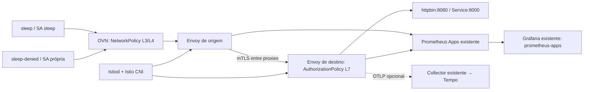

# Arquitetura do laboratório

O diagrama mostra camadas lógicas; NetworkPolicy opera sobre pacotes dos pods, sem identidade de ServiceAccount. O proxy aplica identidade SPIFFE e operações HTTP. O trecho app→proxy pode usar HTTP local enquanto proxy→proxy usa mTLS. `sleep-denied` tem seu próprio ServiceAccount, Deployment e seletores; não pode herdar a identidade de `sleep`.

O discovery selector limita o Mesh a namespaces `istio-discovery=mesh-crc`. A tag estável `mesh-crc` referencia o Istio de mesmo nome. O nome real de `IstioRevision` é consultado em `status.istioRevision` da tag, sem derivar o nome da versão. O destino usa `cluster.local`, valor configurado em `meshConfig.trustDomain`.

Plano de controle com uma réplica e três proxies modestos para estudo. Não há HA, garantia de capacidade nem SLA. A instalação do CNI é uma mudança de infraestrutura no nó e exige revisão separada, mesmo no laboratório.
